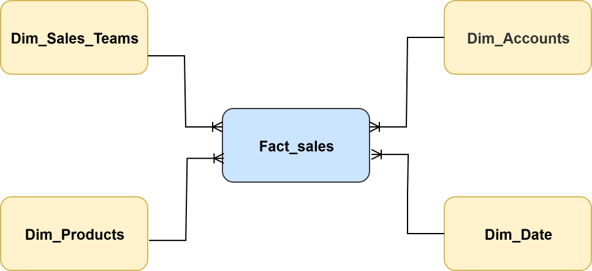
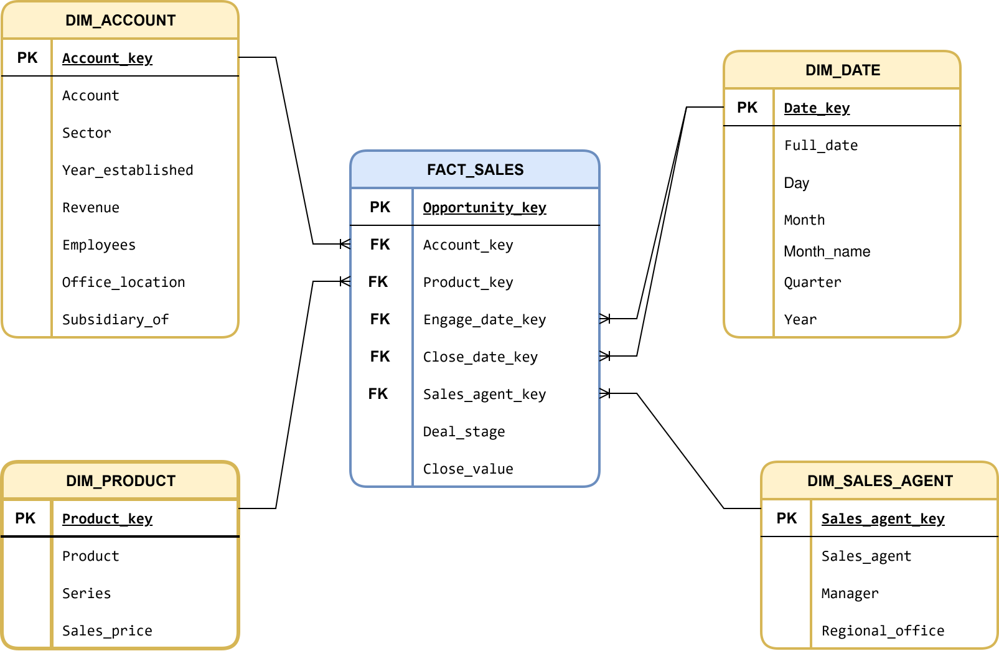
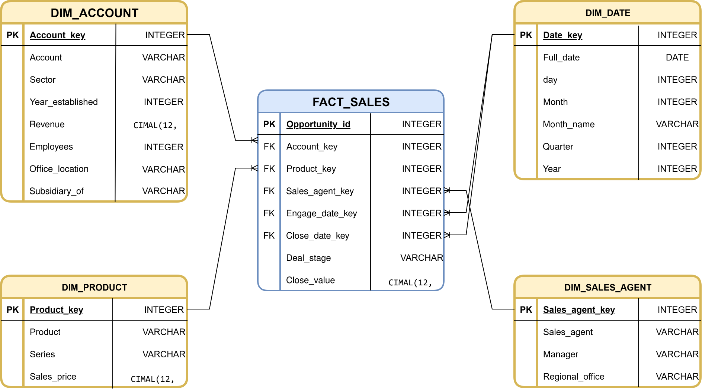
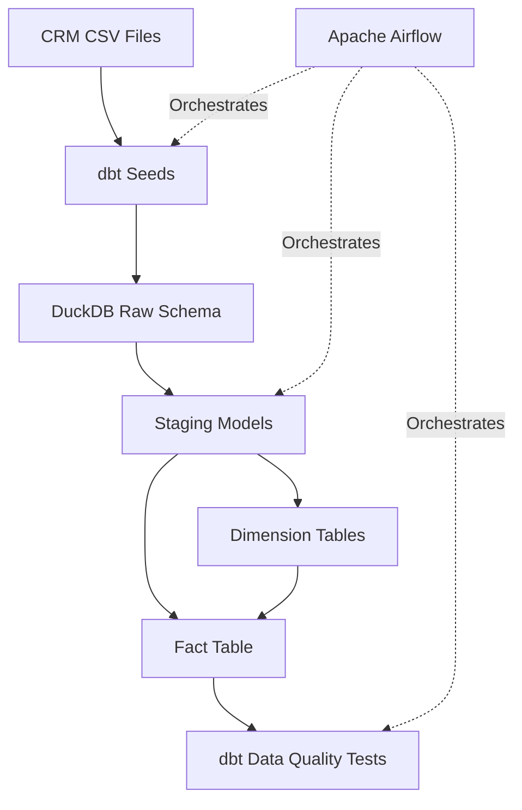

# CRM Sales Data Warehouse

## Project Overview

This project implements an end-to-end **ELT (Extract, Load, Transform) data pipeline** for CRM sales data using DuckDB, dbt, and Apache Airflow.

The pipeline loads raw CSV files into DuckDB using dbt Seeds, transforms the data into staging models and dimensional marts, and validates data quality through automated dbt tests. Apache Airflow orchestrates the workflow.

## Architecture

The pipeline follows this sequence:

1. **Extract:** Use the provided CRM sales CSV files as source data.
2. **Load:** Load the CSV files into DuckDB using `dbt seed`.
3. **Transform:** Build staging models, dimension tables, and a fact table using `dbt run`.
4. **Test:** Validate data quality and fact-to-dimension relationships using `dbt test`.
5. **Orchestrate:** Execute the steps in order through an Apache Airflow DAG.

## Technologies

- **DuckDB** — Analytical database and data warehouse.
- **dbt** — SQL transformations, model dependencies, and data quality tests.
- **Apache Airflow** — Workflow orchestration and scheduling.
- **Docker & Astro CLI** — Local Airflow environment.
- **SQL & CSV** — Data transformation and source data formats.

## Project Structure

```text
CRM-Sales/
├── airflow/
│   ├── dags/
│   │   └── crm_sales_pipeline.py
│   ├── Dockerfile
│   ├── docker-compose.override.yml
│   └── requirements.txt
├── data/
│   ├── accounts.csv
│   ├── data_dictionary.csv
│   ├── products.csv
│   ├── sales_pipeline.csv
│   └── sales_teams.csv
├── dbt/
│   ├── profiles.yml
│   └── crm_sales/
│       ├── dbt_project.yml
│       ├── seeds/
│       ├── models/
│       │   ├── staging/
│       │   ├── marts/
│       │   └── schema.yml
│       └── tests/
│           └── fact_foreign_keys.sql
└── docs/
    ├── CRM_Sales_Documentation.pdf
    ├── Conceptual_Schema.svg
    ├── Logical_Schema.svg
    ├── Physical_Schema.svg
    ├── Modeling.png
    └── Airflow.png
```

## Data Modeling

The warehouse follows a dimensional modeling approach based on a star schema.

### Staging Models

- `stg_accounts`
- `stg_products`
- `stg_sales_pipeline`
- `stg_sales_teams`

These models prepare the source data for downstream transformations.

### Dimension Tables

| Model | Purpose |
|---|---|
| `dim_account` | Account attributes |
| `dim_product` | Product attributes |
| `dim_sales_agent` | Sales agent, manager, and regional office |
| `dim_date` | Date dimension and date keys |

### Fact Table

**`fact_sales_opportunity`**

Stores sales opportunity records, including the opportunity identifier, dimension keys, deal stage, engagement date key, close date key, and close value.

The dimension models generate surrogate keys using DuckDB's `HASH()` function and include an Unknown member with key `0` for unresolved dimension lookups.

## Database Schemas

### 1. Conceptual Schema



*High-level view of the main business entities and their relationships.*

### 2. Logical Schema



*Logical representation of the dimensional model and its relationships.*

### 3. Physical Schema



*Physical database design, including tables, columns, and data types.*

## ELT Data Flow



## Airflow Orchestration

The pipeline is orchestrated by the `crm_sales_pipeline` DAG.

Tasks execute in this order:

```text
dbt_seed → dbt_run → dbt_test
```

- **`dbt_seed`:** Loads the source CSV files.
- **`dbt_run`:** Builds the staging and dimensional models.
- **`dbt_test`:** Runs the data quality tests.

The DAG is configured with a daily schedule and `catchup=False`.

## Data Quality and Testing

The project includes **17 dbt data tests**, covering:

- Not-null constraints.
- Uniqueness constraints.
- Fact table foreign-key relationships.

### Validation Results

| Component | Result |
|---|---:|
| Seeds | 5 successful |
| dbt Models | 9 successful |
| Data Tests | 17 passed |
| Errors | 0 |

The pipeline and tests were successfully executed during local validation.

## Running the Pipeline

Run the following commands from the dbt project directory, with the appropriate profiles directory configured:

```bash
dbt seed --profiles-dir ../
dbt run --profiles-dir ../
dbt test --profiles-dir ../
```

The Airflow DAG orchestrates these commands automatically.

## Engineering Skills Demonstrated

- ELT pipeline design.
- Dimensional modeling and star schema design.
- SQL transformations using dbt.
- Surrogate key generation and dimension lookups.
- Data quality testing.
- Workflow orchestration with Apache Airflow.
- Containerized local development using Docker.
